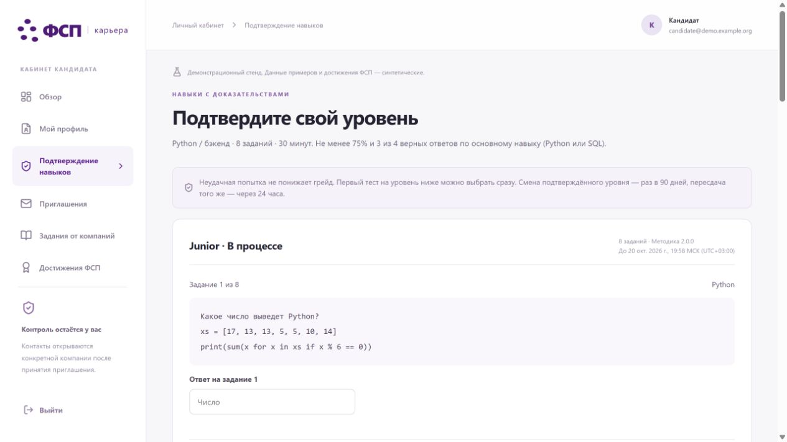
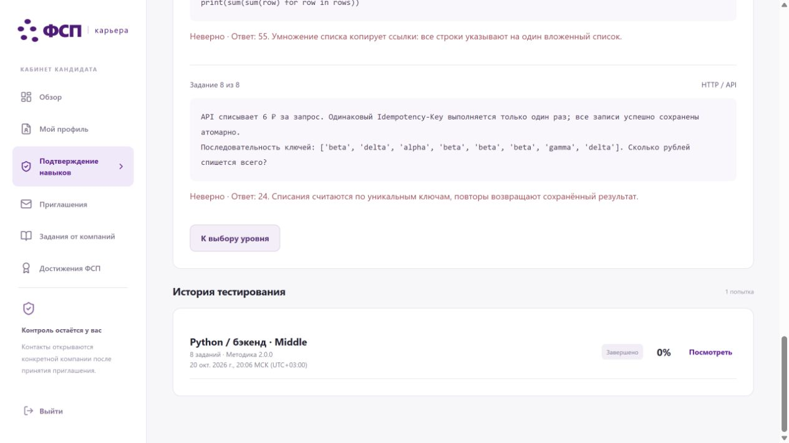
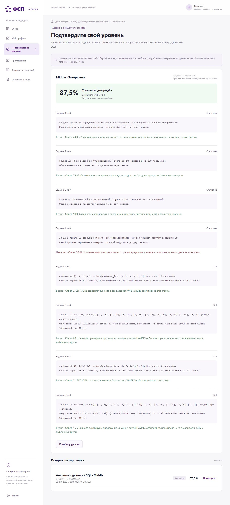
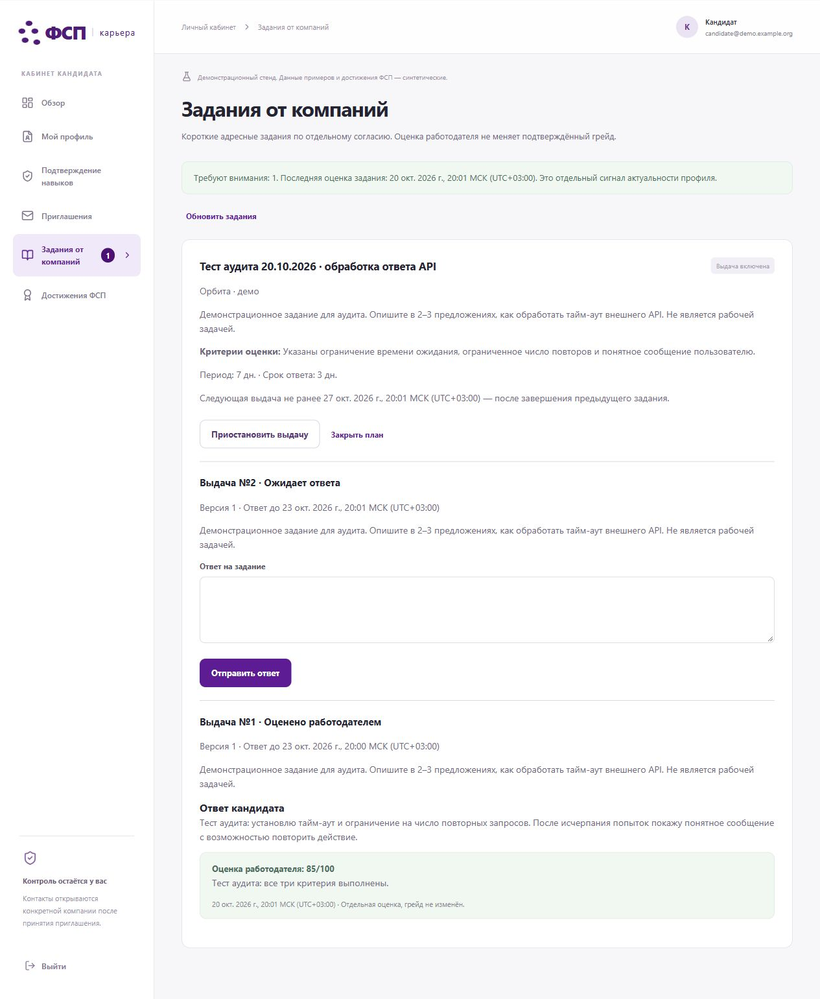
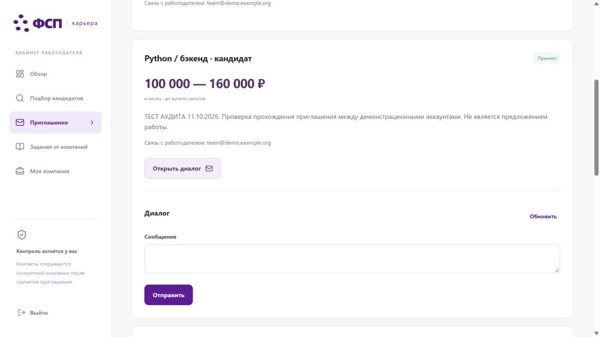
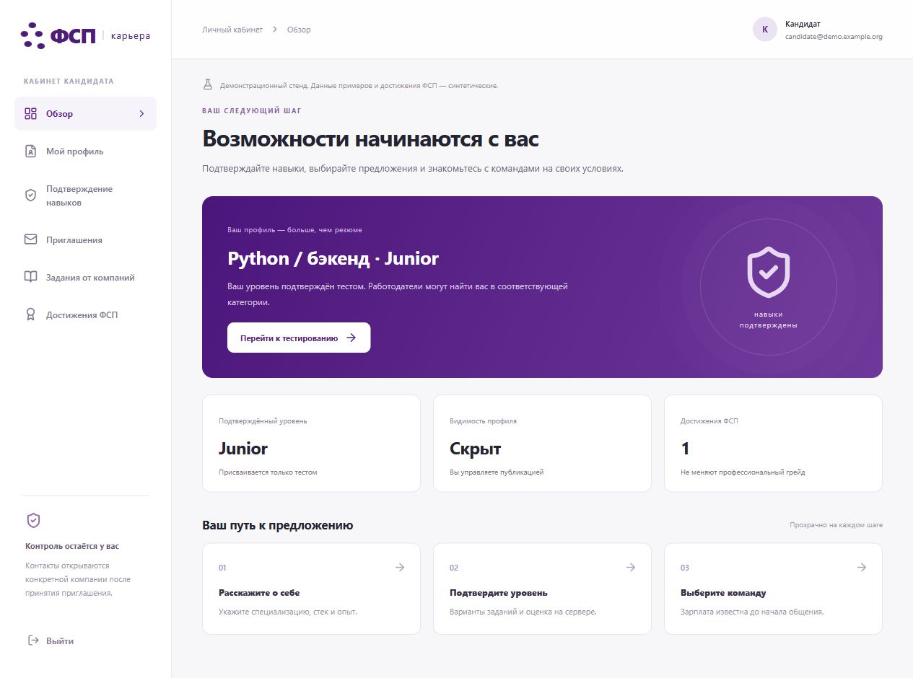

# Что изменилось после созвона и аудита (20→21 октября)

После замечаний организаторов и аудита 20.10 продукт доработан для самостоятельной проверки. Ниже — что изменилось, где смотреть на стенде и как выглядели проблемы до правок.

**Стенд:** https://85-137-26-131.sslip.io/  
**Сценарий проверки:** [FOR_JURY.md](FOR_JURY.md)  
**Подробная история правок:** [CHANGELOG_STAGE_A.md](CHANGELOG_STAGE_A.md)

---

## Что закрыли в продукте

| Тема | Было (аудит 20.10) | Сейчас на стенде | Где посмотреть |
|---|---|---|---|
| Черновик теста | Ответы терялись при уходе в другой раздел | Ответы активной попытки сохраняются; при сбое сети есть предупреждение | Кандидат → «Подтверждение навыков»: ответить → «Обзор» → вернуться |
| Сдача с пропусками | Можно было завершить без явного подтверждения | Перед сдачей — подтверждение с числом пустых заданий; отмена сохраняет попытку | Там же, при попытке сдать незаполненный тест |
| Округление | Спорный / неочевидный результат | Правило зафиксировано в банке 2.1.1; старые попытки не пересчитывались | История попытки → «Посмотреть» |
| Подбор | Балл плохо читался | В карточке — «Почему в подборке» и составляющие балла | Работодатель → «Подбор кандидатов» |
| Согласие и доступ | Тексты и доступ расходились с фактом | Скрытие профиля закрывает поиск, диалог и PDF; контакты снова — только после нового принятого приглашения | Сценарий в FOR_JURY, блок про отзыв доступа |
| Задания компании | Пауза могла дать ранний дубль | Пауза сохраняет дату следующей выдачи | «Задания от компаний» в сценарии |
| Веса подбора | Нужна проверка на выборке, не произвольная подкрутка | Веса зафиксированы версией формулы; на отложенной выборке метрика точности в топ-5 осталась 0,80 — улучшения не заявляем | [CURRENT_STATUS_2026-10-21.md](CURRENT_STATUS_2026-10-21.md) |

Скриншоты из аудита стенда 20.10 — как выглядело до правок:

**Потеря ответа при уходе из теста**

**Завершение с пропусками без предупреждения**

**Спорное округление**

**Дубль задания после паузы**

**После отзыва доступа: диалог и профиль**

---

## Что ещё появилось 21.10

- Удобный повторный проход: «Я кандидат» / «Я работодатель», обычное окно + инкогнито, продолжение по статусу приглашения — см. [FOR_JURY.md](FOR_JURY.md).
- В диалоге работодателя — карточка кандидата и скачивание PDF профиля.
- Отдельно от публичного демо — комплект установки у заказчика: [READY_TO_DEPLOY_ONEPAGER.md](closed_contour/READY_TO_DEPLOY_ONEPAGER.md).

---

## Проверки, которые уже прогоняли

Цифры — из протоколов конкретных прогонов 21.10.

- Серверные тесты на актуальной версии сдачи: 132 пройдены — см. [STAGE_A_SMOKE.md](STAGE_A_SMOKE.md).
- Живой прогон по HTTPS после ручной приёмки: 24 группы без ошибок в журнале страницы — [live-smoke.json](evidence/human_followup_2026-10-21/live-smoke.json).
- Повтор сценария для жюри: два полных прохода — [jury_replay_2026-10-21.json](evidence/jury_replay_2026-10-21.json).
- Профиль и PDF в переписке: [chat_candidate_2026-10-21.json](evidence/chat_candidate_2026-10-21.json).

Актуальная сверка плана: [CURRENT_STATUS_2026-10-21.md](CURRENT_STATUS_2026-10-21.md).

---

## Что проектируем дальше

Следующую версию платформы мы проектируем как мультиагентную систему: гибридный семантический поиск, GraphRAG по подтверждённым компетенциям, специализированные агенты через MCP и исполняемая проверка практических навыков кодом. Каждая рекомендация должна быть объяснима и связана с реальным результатом кандидата.

В текущем MVP основа для этого уже есть: «Почему в подборке», «Не проверено», адресные задания с оценкой, версионированная формула подбора. Архитектурный план: [AGENTIC_ROADMAP.md](AGENTIC_ROADMAP.md).

---

## Что ещё не закрыто

- Отправка ссылок организаторам — действие команды.
- Рост качества подбора на отложенной выборке не показан (0,80 → 0,80).
- Официальный реестр ФСП и пилот с людьми — не в этом объёме.
- Юридическая приёмка заказчика по закрытому контуру — отдельно.
