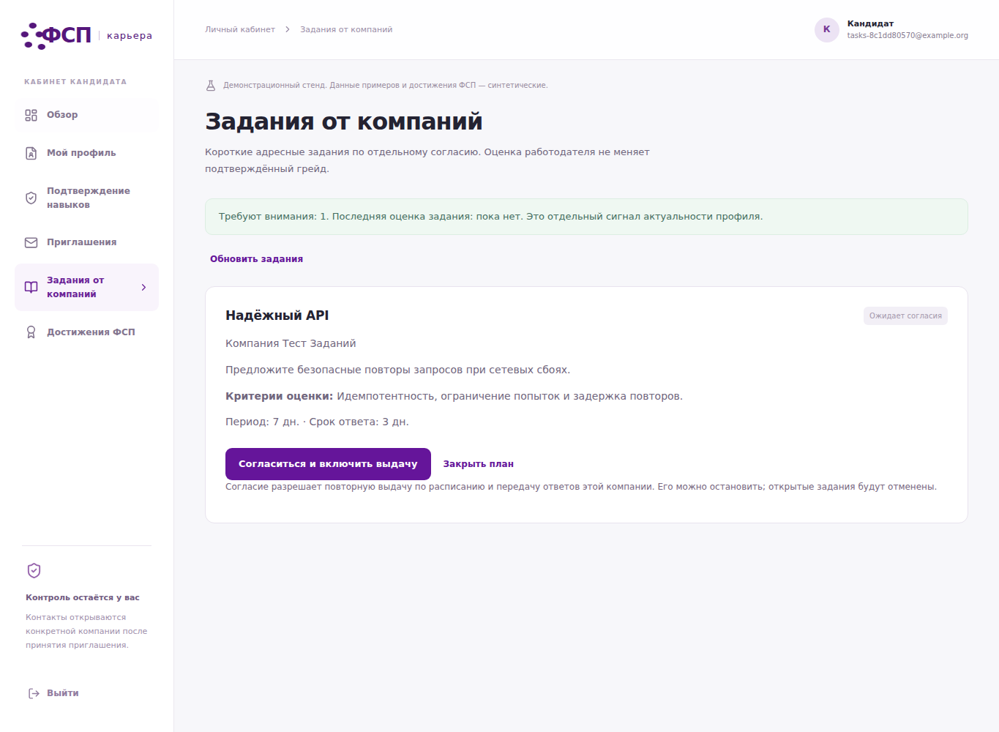
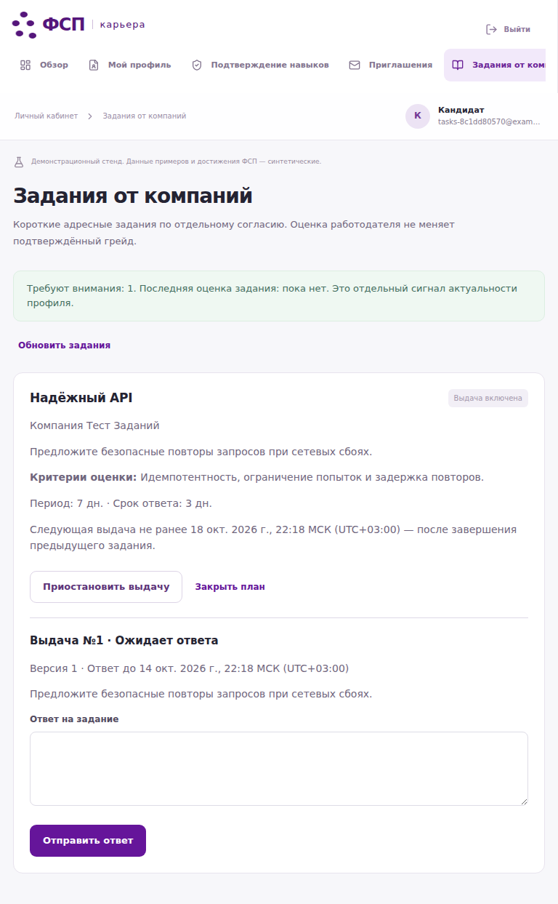
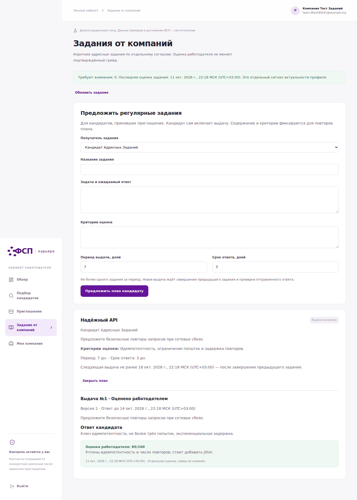
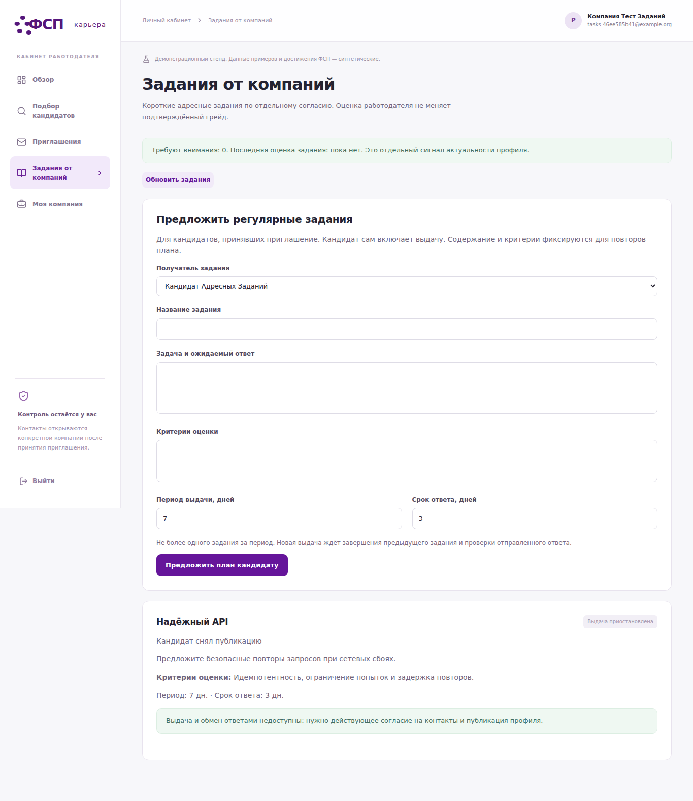
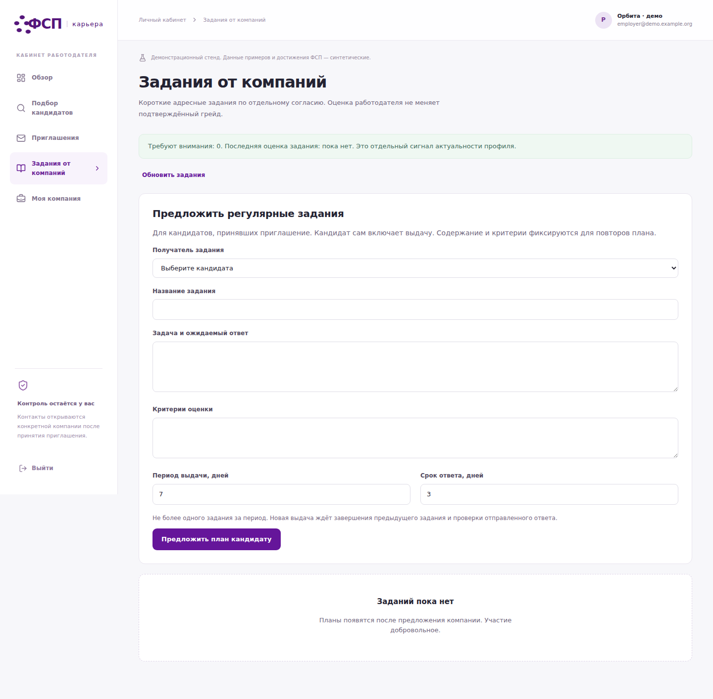

# Проверки и экраны модернизации

11 октября 2026. Вымышленные аккаунты; реальные CV/ключи/дампы не публикуются.

- [Backend](backend.txt): 84 passed после объединения кода коллег.
- [Полная первоначальная приёмка](acceptance-staging.json), [финальный UI объединённого кода](acceptance-merged.json).
- [18 требований](requirements.json), [11 проверок адресных заданий](tasks.json).
- [Чистая установка и восстановление](clean-install.json), [развёртывание](deployment.json).
- [Публичный HTTPS без отправки почты](public-acceptance.json).
- [Человеческий пилот](human-pilot.json), [независимый ranking](independent-ranking.json): not_run, наблюдения отсутствуют.
- [Хеши исходников](source-sha256.json), SHA256SUMS — целостность, не внешняя сертификация.

Исходные логи остаются в audit/modernization, включая неуспешные промежуточные
прогоны. API-ответы до согласия/после отзыва проверялись отдельно; скриншот
сам по себе не является доказательством контроля доступа.

